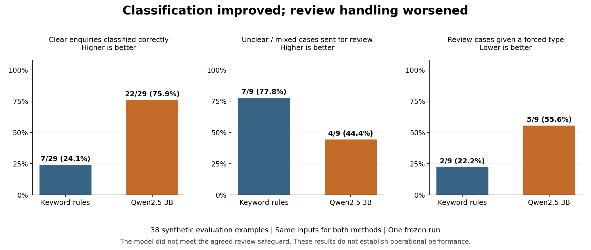

# AI Use-Case Assessment and Data Readiness

A business analysis case study comparing improvements to municipal enquiry handling, supported by a local classification experiment and an enquiry-tracking prototype.

Updated November 14, 2026. The assessment, prototypes and evaluation are documented. The final recommendation is available for review.

## Main finding

On 38 frozen synthetic evaluation examples, Qwen2.5 3B correctly classified 22 of 29 clear enquiries, compared with 7 for a simple keyword baseline. However, AI correctly flagged only 4 of 9 unclear/mixed cases for review, compared with 7 for the baseline. It did not meet the pre-agreed review safeguards. Neither tested approach is recommended for operational rollout from this evidence.

Forty evaluation candidates were prepared; two development-overlap cases were excluded before predictions. The small synthetic dataset, related examples, lack of independent service-owner validation and simple baseline limit the conclusions. See the [results and limitations](docs/06-evaluation/classification-results-and-recommendation.md).



## Work available for review

- [Sponsor request and business context](docs/01-plan/sponsor-request-memo.md).
- [Interview walkthrough](docs/00-interview-walkthrough.md) and [contribution record](ai-assistance-and-ownership-log.md).
- [Options comparison](docs/04-options/evidence-and-data-comparison.md), [data-readiness assessment](docs/04-options/data-readiness-assessment.md) and [final recommendation](docs/06-evaluation/final-recommendation.md).
- [Experiment brief](docs/04-options/classification-experiment-brief.md), [labelling guide](data/labelling-guide.md), [evaluation plan](docs/06-evaluation/classification-evaluation-plan.md) and [classification run guide](prototype/classification/README.md).
- [Current-state intake summary](docs/03-current-state/intake-process-summary.md) and [connected practice records](docs/03-current-state/practice-records/README.md).
- [Tracking requirements and acceptance criteria](docs/05-requirements/tracking-prototype-requirements.md).
- [Seven designed test cases](docs/06-evaluation/tracking-prototype-test-cases.md), [test summary](docs/06-evaluation/tracking-prototype-test-summary.md) and [versioned execution evidence](results/tracking-prototype/README.md).
- [Initial discussion examples](data/README.md), separate from the twenty classification development examples and thirty-eight evaluated examples.

## Reproduce the classification work

The keyword development check uses Python's standard library:

```powershell
python prototype/classification/run_development.py
```

AI execution requires a local Ollama installation and the recorded Qwen2.5 3B model. See the [classification guide](prototype/classification/README.md) for commands, model/settings evidence and retained results. The final-run script refuses to overwrite its existing run. Do not rerun a now-seen evaluation set and call the result unseen, or re-run the dataset-preparation script over frozen data.

## Run the supporting application

Requires Python 3.12; no external packages or paid services are needed. From the repository root:

```powershell
python prototype/tracking/app.py --init
python prototype/tracking/app.py --port 8766
```

Open http://127.0.0.1:8766. Generated test passwords and the working database stay in the ignored `prototype/tracking/local-data/` directory. Never upload them. See the [application guide](prototype/tracking/README.md) for roles, limitations and test instructions.

Run the automated checks with:

```powershell
python prototype/tracking/test_acceptance.py
```

This application demonstrates enquiry tracking and handover; it is separate from the AI classification experiment. It was accepted for its learning purpose in conversation, and a clean assisted browser persistence repeat passed. Results apply to the local prototype, not a municipality's system. Operational guidance publication remains on hold. The [optional Azure pipeline definition](prototype/tracking/azure-pipelines.yml) is supplied but has not been configured or run in Azure DevOps.

## Business question

Which AI opportunity should the organization pursue first, and what must be ready before it proceeds?

## Approach taken

1. Define the citizen-enquiry process, its problems, and the evidence needed to assess them.
2. Compare enquiry routing, FAQ assistance, and enquiry trend analysis against consistent criteria.
3. Assess data readiness and consider simpler non-AI alternatives.
4. Select a narrow enquiry-type classification task that avoids unverified departmental destinations.
5. Compare keyword rules with one local AI model, document the observed trade-off and recommend next steps.

The initial routing candidate was narrowed to reported enquiry type: missed collection, reported dumped waste, or Other, with a separate review outcome for unclear/mixed requests. The experiment does not decide department ownership or service eligibility.

See [Project scope](docs/project-scope.md) for boundaries and intended evidence.

## Context and disclosure

The assessment is inspired by Deliverable D3 of RFS-230-2026, Use-Case Assessment and Data Readiness Report. This is a smaller learning exercise. The prototype is an independent extension; the RFS excludes use-case implementation.

This project is for learning and portfolio purposes: the scenario and stakeholder conversations are simulated, the enquiry data is synthetic, and no municipal interviews or operational measurements were conducted; it is not commissioned by or affiliated with any government or agency.

This portfolio was created using AI for stakeholder role-play, research support, drafting, code, synthetic data and testing, with the author reviewing decisions and findings.

Free tools were used; no paid inference service was used. Hardware, electricity and staff effort were not costed. The repository and Azure Boards reflect the completed experiment. Final recommendation review remains; no further model tuning or tracking features are planned.
