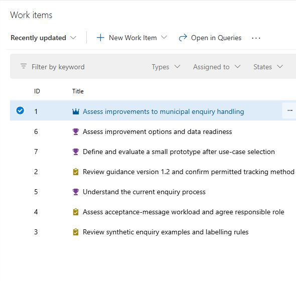

# Municipal Enquiry Assessment

## Project overview

This business analysis case study starts with a service problem: how can customer-service staff provide a correct answer or referral without residents repeating information or chasing progress?

The work examines intake, missing information, responsibility and handoffs before comparing possible improvements. Unresolved departmental boundaries led to a smaller experiment: classify the enquiry topic rather than decide which department owns it. The assessment compares routing assistance, FAQ assistance, trend analysis and improvements to guidance and intake.

**Status:** Assessment, local prototypes and evaluation documented. Final recommendation available for review.

**Start here:** [Interview walkthrough](docs/00-interview-walkthrough.md) | [Options comparison](docs/04-options/evidence-and-data-comparison.md) | [Final recommendation](docs/06-evaluation/final-recommendation.md)

## Main result

On 38 synthetic evaluation examples, Qwen2.5 3B correctly classified **22/29 clear enquiries**, compared with **7/29** for keyword rules. However, it correctly flagged only **4/9 unclear or mixed cases** for review, compared with **7/9** for rules. It failed the agreed review safeguard. Neither tested method is recommended for operational rollout.

The small synthetic dataset, related examples, lack of independent service-owner validation and simple baseline limit the conclusions. No operational savings or service improvements were measured.


## The BA framework

The ten stages below provide a reading path through the project. They are not a claim that every possible BA deliverable was needed or produced. Analysis moved between stages as evidence changed.

| Stage | Question and reasoning | Evidence and position |
|---|---|---|
| 1. Business problem | What outcome is needed, and what evidence supports investigating it? Separate published context from assumptions about the cause. | [Sponsor request](docs/01-plan/sponsor-request-memo.md), [evidence review](docs/01-plan/evidence-review.md) and [scope](docs/project-scope.md). Operational prevalence and benefits were not established. |
| 2. Stakeholders | Who performs the work, who approves instructions, and who can settle disputed responsibility? | [Elicitation notes](docs/03-current-state/elicitation-notes-2026-11-08.md) and [delegation record](docs/03-current-state/practice-records/05-delegation-record.md). Roles informed the scenario; no real service-owner validation. |
| 3. As-Is process | What happens from receipt to acceptance, including missing details and exceptions? Distinguish acceptance from resolution. | [Intake process summary](docs/03-current-state/intake-process-summary.md) and [connected records](docs/03-current-state/practice-records/README.md). Written walkthrough; no separate process diagram. |
| 4. Options and recommendation | Which response can be assessed with the available information? Consider simpler process changes alongside technology. | [Options comparison](docs/04-options/evidence-and-data-comparison.md) and [data-readiness assessment](docs/04-options/data-readiness-assessment.md). Qualitative comparison; no unsupported financial ranking. |
| 5. To-Be process | What should staff record, retain and hand over? Which instructions depend on approval or system verification? | [Revised guidance draft](docs/03-current-state/practice-records/07-missed-collection-guidance-v1.2-draft.md) and [tracking requirements](docs/05-requirements/tracking-prototype-requirements.md). Proposed behaviour is documented; operational publication remains on hold. |
| 6. Business and functional requirements | What behaviour is required, what is excluded, and what would demonstrate success? | [Tracking requirements and acceptance criteria](docs/05-requirements/tracking-prototype-requirements.md), [experiment brief](docs/04-options/classification-experiment-brief.md) and [evaluation measures](docs/06-evaluation/classification-evaluation-plan.md). Requirements are proportionate specifications, not separate BRD/FRD documents. |
| 7. User stories and backlog | How are actions, dependencies, completion conditions and review decisions tracked? | [Azure Boards](https://dev.azure.com/W0850313/AI%20Enquiry%20Assessment/_workitems). Azure Boards was used instead of Jira. Access requires permission; the repository contains the supporting evidence. |
| 8. Wireframes and interface | How can the required workflow be demonstrated and checked? | [Runnable tracking prototype](prototype/tracking/README.md). A working local interface was used; no Figma wireframes were produced. |
| 9. Test scenarios | Does observed behaviour meet the criteria, including errors, access restrictions and uncertainty? | [Tracking test cases](docs/06-evaluation/tracking-prototype-test-cases.md), [test summary](docs/06-evaluation/tracking-prototype-test-summary.md), [classification results](docs/06-evaluation/classification-results-and-recommendation.md) and [retained predictions](results/classification/held-out-final/predictions.json). |
| 10. Change request management | What changed, what authorised it, and what needs review before release? | [Article versions](docs/03-current-state/practice-records/03-article-versions.md), [approval conditions](docs/03-current-state/practice-records/06-guidance-approval-record.md) and [prompt revision review](results/classification/prompt-revision-review.md). These show change and approval analysis; no formal enterprise change-request workflow was implemented. |

## Azure Boards

Work was tracked through an assessment epic, features and tasks. The captures show the recorded scope and findings, with final review still pending. [View all four screenshots](docs/azure-boards-evidence.md).



## Case study: municipal enquiry handling

### The problem

The scenario explores incomplete enquiries, repeated ownership checks and uncertain handoffs. The BA task was to distinguish reported concerns from verified causes, identify the information needed for a decision and avoid treating a returned request as proof of an ownership dispute.

### The solution assessed

The project compared four improvement options, then tested enquiry-type classification using keyword rules and one local model. The categories were missed collection, reported dumped waste and Other, with a separate review outcome for unclear or mixed reports. Missing addresses and dates remained separate intake issues.

A supporting enquiry-tracking prototype demonstrated saved records, responsibility, absence cover, permissions and change history. It is separate from the classifier and was accepted for its demonstration purpose with documented limitations.

### Business value and recommendation

The assessment identifies the conditions needed before an operational decision: agreed responsibilities, reliable labels, approved guidance and evidence of staff workload and service outcomes. The experiment shows why better classification counts alone are insufficient when ambiguous enquiries are handled less safely.

The recommendation is to stop this experiment, retain the results and investigate clearer guidance and intake as a foundation. No measured financial or service benefit is claimed. See the [final recommendation](docs/06-evaluation/final-recommendation.md).

## Repository guide

The existing folders organise evidence by its purpose. Links above connect them into the end-to-end framework without duplicating files.

```text
ai-enquiry-routing-assessment/
|-- README.md
|-- ai-assistance-and-ownership-log.md
|-- docs/
|   |-- 00-interview-walkthrough.md
|   |-- project-scope.md
|   |-- 01-plan/                 # Business context and source evidence
|   |-- 03-current-state/        # Elicitation, intake and linked practice records
|   |-- 04-options/              # Comparison, readiness and experiment scope
|   |-- 05-requirements/         # Behaviour and acceptance criteria
|   |-- 06-evaluation/           # Test cases, findings and recommendations
|   `-- images/                  # Result charts
|-- data/                        # Synthetic examples, labels and frozen snapshots
|-- prototype/
|   |-- classification/         # Keyword baseline and local model evaluation
|   |-- tracking/               # Supporting enquiry application
|   |-- config/                 # Practice configuration
|   `-- checks/                 # Supporting inspection scripts
`-- results/                    # Retained execution evidence
```

The [contribution record](ai-assistance-and-ownership-log.md) describes the author's work. The [dataset plan](docs/06-evaluation/classification-dataset-plan.md), [labelling guide](data/labelling-guide.md) and [freeze record](data/classification-evaluation/evaluation-freeze.json) explain how the examples were prepared and reviewed.

## For recruiters and hiring managers

Begin with the [interview walkthrough](docs/00-interview-walkthrough.md), then follow the framework links to inspect the reasoning, requirements and test evidence. The [results](docs/06-evaluation/classification-results-and-recommendation.md) and [recommendation](docs/06-evaluation/final-recommendation.md) show how the findings informed the decision. The local run guides below support a closer technical review.

## Reproduce the classification work

The keyword development check uses Python's standard library:

```powershell
python prototype/classification/run_development.py
```

AI execution requires a local Ollama installation and the recorded Qwen2.5 3B model. See the [classification guide](prototype/classification/README.md) for commands, model/settings evidence and retained results. The final-run script refuses to overwrite its existing run. Do not rerun a now-seen evaluation set and call the result unseen, or re-run the dataset-preparation script over frozen data.

## Run the supporting application

Requires Python 3.12; no external packages or paid services are needed. From the repository root:

```powershell
python prototype/tracking/app.py --init
python prototype/tracking/app.py --port 8766
```

Open http://127.0.0.1:8766. Generated test passwords and the working database stay in the ignored `prototype/tracking/local-data/` directory. Never upload them. See the [application guide](prototype/tracking/README.md) for roles, limitations and test instructions.

Run the automated checks with:

```powershell
python prototype/tracking/test_acceptance.py
```

This application demonstrates enquiry tracking and handover; it is separate from the AI classification experiment. It was accepted for its learning purpose in conversation, and a clean assisted browser persistence repeat passed. Results apply to the local prototype, not a municipality's system. Operational guidance publication remains on hold. The [optional Azure pipeline definition](prototype/tracking/azure-pipelines.yml) is supplied but has not been configured or run in Azure DevOps.

## Context and disclosure

The assessment is inspired by Deliverable D3 of RFS-230-2026, Use-Case Assessment and Data Readiness Report. This is a smaller learning exercise. The prototype is an independent extension; the RFS excludes use-case implementation.

This project is for learning and portfolio purposes: the scenario and stakeholder conversations are simulated, the enquiry data is synthetic, and no municipal interviews or operational measurements were conducted; it is not commissioned by or affiliated with any government or agency.

This portfolio was created using AI for stakeholder role-play, research support, drafting, code, synthetic data and testing, with the author reviewing decisions and findings.

Free tools were used; no paid inference service was used. Hardware, electricity and staff effort were not costed. The repository and Azure Boards reflect the completed experiment. Final recommendation review remains; no further model tuning or tracking features are planned.
