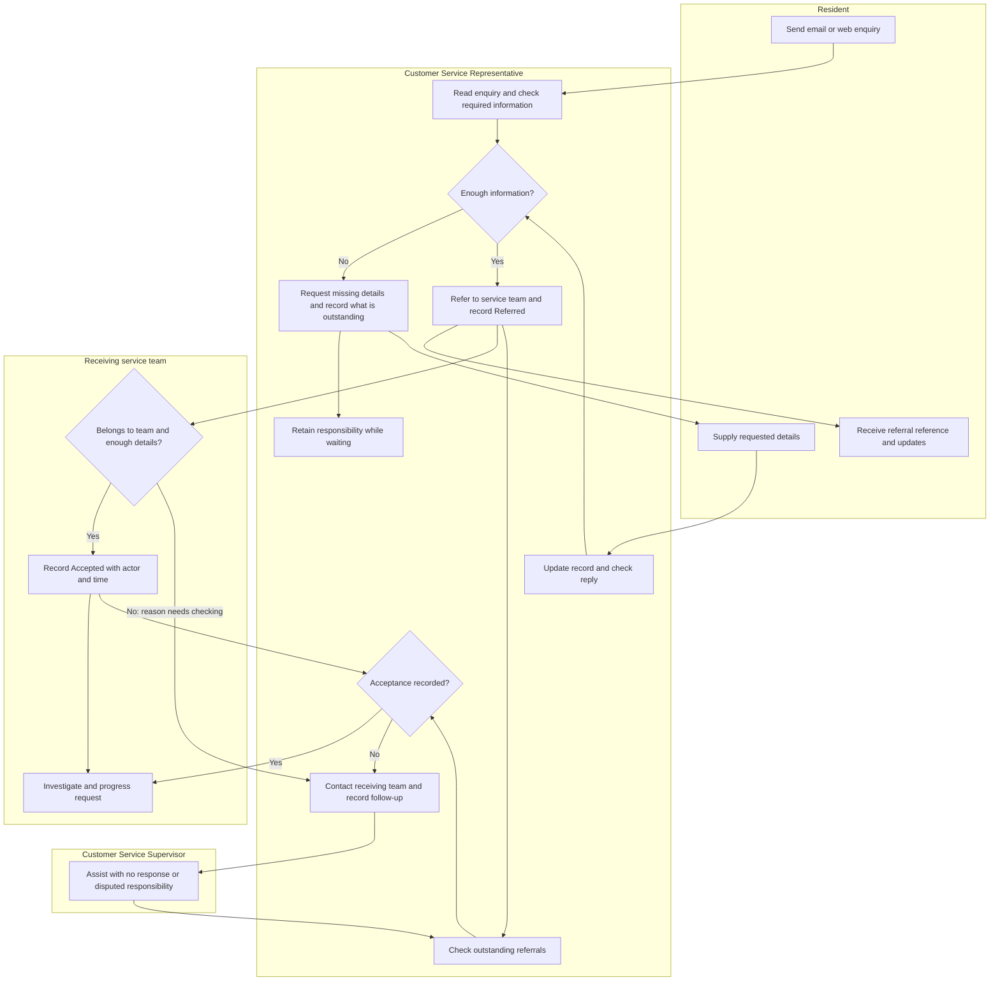
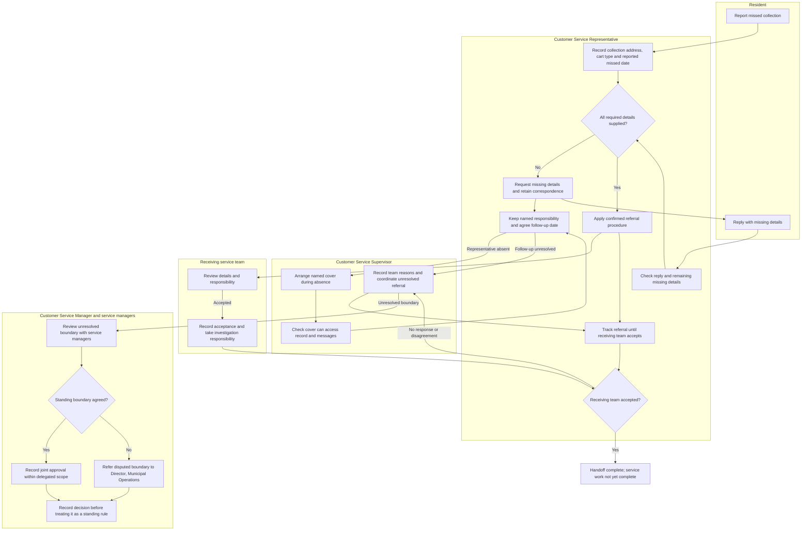

# Enquiry handling process maps

These maps consolidate the recorded walkthrough and proposed guidance. They do not add a service standard or confirm municipal practice.

## As-Is: walkthrough account

Based on the [intake summary](intake-process-summary.md), steps 1–7, and the [elicitation notes](elicitation-notes-2026-11-08.md), representative account. The system statuses below were described during the walkthrough; no operational system was inspected. The map covers a referral case. Direct answers were mentioned but not walked through.

Waiting for a resident or a team does not transfer tracking responsibility. A return alone does not prove an ownership dispute. Acceptance is not resolution or a promised collection date.

## To-Be: proposed missed-collection handling

Based on [G-01](practice-records/06-guidance-approval-record.md), [draft version 1.2](practice-records/07-missed-collection-guidance-v1.2-draft.md), [D-01](practice-records/05-delegation-record.md) and the interim direction in the [elicitation notes](elicitation-notes-2026-11-08.md). Collection details and named responsibility have scenario approval. The permitted tracking method, final wording, publication and briefing conditions remain unresolved. This is a proposed process, not released staff guidance.

The tracking method must be verified before guidance release. This map prescribes no unverified status, field, reminder, automatic reassignment or automatic closure. The model experiment does not decide departmental ownership. Responsibility for sending the acceptance acknowledgement is not established by these sources.

## Legend

1. Role boxes group actions by the person or team described in the source.
2. Rectangles show actions or recorded outcomes.
3. Diamonds show a decision that needs evidence.
4. Labelled arrows show the reason for a branch or a repeat check.
5. A handoff ends tracking only after acceptance; it does not show service resolution.
