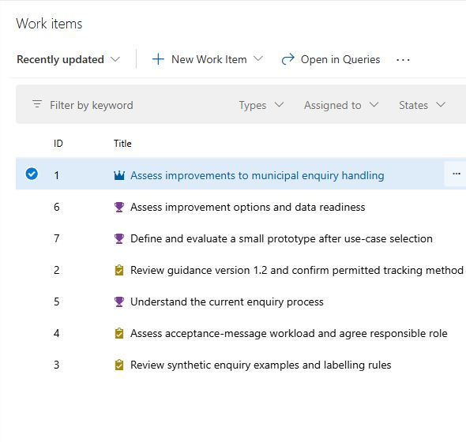
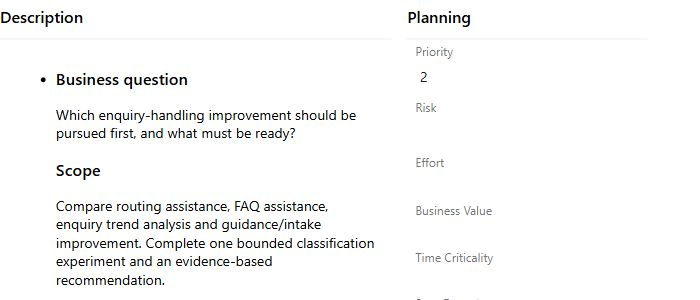
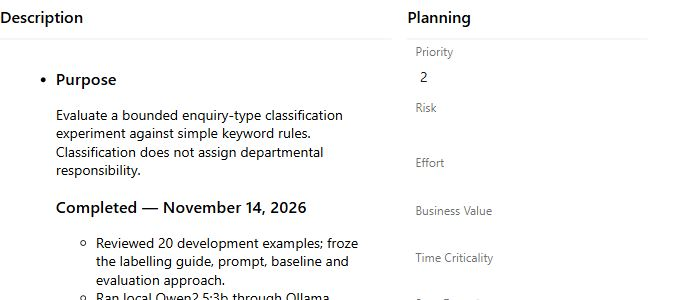
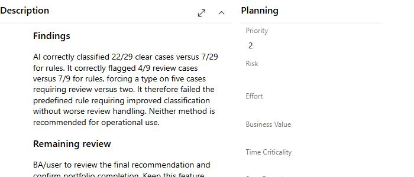

# Azure Boards evidence

Captured November 14, 2026. Cropped screenshots omit account details and show the project at the time of capture; they are not a live status feed. Final portfolio review remains pending, and operational guidance publication remains on hold.

## Work items

The work-item list shows the assessment epic, options and prototype features, and supporting tasks. This view is filtered to recently updated items; it is not a complete list of closed work.

## Assessment scope

The epic records the business question, comparison scope and project progress.

## Experiment completion

The prototype feature records the frozen evaluation, retained evidence and completed tracking demonstration.

## Findings and remaining review

The feature remains Active pending final review. Higher clear-case classification did not meet the agreed safeguard for unclear and mixed cases. Neither method is recommended for operational use.

[Live Azure Boards project](https://dev.azure.com/W0850313/AI%20Enquiry%20Assessment/_workitems) (permission required). [Final recommendation](06-evaluation/final-recommendation.md).
